  

  <a href="#sobre-mí">Sobre mí</a> ·
  <a href="#proyectos">Proyectos</a> ·
  <a href="#tecnologías">Tecnologías</a> ·
  <a href="#archivo-de-proyectos">Archivo</a> ·
  <a href="#contribuciones">Contribuciones</a> ·
  <a href="https://github.com/ESGE-2804?tab=repositories">Repositorios</a>

## Sobre mí

Soy **Emilio Granda**, ingeniero de sistemas de **Ecuador**. Me interesan la ciberseguridad, el monitoreo de redes y la infraestructura. También desarrollo aplicaciones web y APIs con Python, FastAPI y AWS.

- **Proyecto actual.** Implementación de monitoreo de red con **Zabbix** y seguridad perimetral con **pfSense**.
- **Infraestructura y desarrollo.** Migración de servicios de **Java a Go** y gestión de contenedores con **Docker**.
- **Ciberseguridad.** Pruebas de penetración en entornos controlados y análisis de vulnerabilidades con **Kali Linux**.

[Escríbeme por correo](mailto:emiliosgranda@gmail.com)

## Proyectos

Una aplicación para generar enlaces cortos. La interfaz se sirve desde **Amazon S3**, la API de **FastAPI** corre en **Amazon EC2** detrás de **Nginx** y **DynamoDB** almacena los enlaces.

[Ver el código y la guía de despliegue →](https://github.com/ESGE-2804/Acortador-de-enlaces-AWS#readme)

<strong>Explorar más proyectos</strong>

| Proyecto | Qué encontrarás |
| :-- | :-- |
| [FastAPI en AWS](https://github.com/ESGE-2804/FastAPI-en-AWS) | Práctica de backend con FastAPI en AWS. |
| [Base de datos en EC2](https://github.com/ESGE-2804/BDD-en-EC2) | Práctica con una base de datos en Amazon EC2. |
| [Frontend](https://github.com/ESGE-2804/Parcial-1-_-5to-Semestre_Frontend) y [Backend](https://github.com/ESGE-2804/Parcial-1-_-5to-Semestre_Backend) | Dos repositorios de un proyecto académico de quinto semestre. |

## Tecnologías

  
  
  
  
  
  

| Área | Herramientas que uso en mis proyectos |
| :-- | :-- |
| Backend | Python · FastAPI · Go · Java · APIs REST |
| Infraestructura | Amazon Web Services · S3 · EC2 · Nginx · Docker · Linux |
| Redes y seguridad | Zabbix · pfSense · Kali Linux |
| Datos | Amazon DynamoDB |

## Archivo de proyectos

Estos proyectos de mi cuenta anterior ya están disponibles aquí con su historial de Git.

| Área | Proyectos |
| :-- | :-- |
| Aplicaciones | [Proyecto final de cuarto semestre](https://github.com/ESGE-2804/4to-Semestre---Proyecto-final) · [Fake Store](https://github.com/ESGE-2804/Fake_Store) · [UIDEPETS en Go](https://github.com/ESGE-2804/Golang_UIDEPETS) |
| Backend e infraestructura | [FastAPI](https://github.com/ESGE-2804/FastAPI) · [Streaming Server](https://github.com/ESGE-2804/Streaming_Server) |
| Prácticas | [Examen práctico](https://github.com/ESGE-2804/First-term-exam---Practical) · [Taller de paquetes](https://github.com/ESGE-2804/Taller_Paquetes) · [HTML](https://github.com/ESGE-2804/HTML) · [Cifrado XOR](https://github.com/ESGE-2804/Encriptador-Desencriptador-XOR) |

## Contribuciones

- [Actividad actual en ESGE-2804](https://github.com/ESGE-2804#contributions)
- [Historial público de Emili0s3bax](https://github.com/Emili0s3bax#contributions)

## Fuera del código

Juego Valorant, Overwatch y GTA V. Escucho black metal y funk rock.

<strong>Mi equipo de trabajo</strong>

- **Modelo** · HP Victus 15
- **GPU** · NVIDIA RTX 2050
- **RAM** · 32 GB DDR4
- **SSD** · 1 TB

