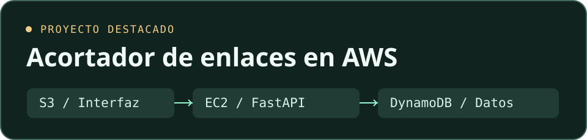

  

  <a href="#proyectos">Proyectos</a> ·
  <a href="#tecnologías">Tecnologías</a> ·
  <a href="https://github.com/ESGE-2804?tab=repositories">Repositorios</a>

Soy **Emilio Granda**. Construyo proyectos que conectan interfaces web, APIs y bases de datos. En mis repositorios exploro cómo desplegar esas piezas en AWS con Python y FastAPI.

## Proyectos

Una aplicación para generar enlaces cortos. La interfaz se sirve desde **Amazon S3**, la API de **FastAPI** corre en **Amazon EC2** detrás de **Nginx** y **DynamoDB** almacena los enlaces.

[Ver el código y la guía de despliegue →](https://github.com/ESGE-2804/Acortador-de-enlaces-AWS#readme)

<strong>Explorar más proyectos</strong>

| Proyecto | Qué encontrarás |
| :-- | :-- |
| [FastAPI en AWS](https://github.com/ESGE-2804/FastAPI-en-AWS) | Práctica de backend con FastAPI en AWS. |
| [Base de datos en EC2](https://github.com/ESGE-2804/BDD-en-EC2) | Práctica con una base de datos en Amazon EC2. |
| [Frontend](https://github.com/ESGE-2804/Parcial-1-_-5to-Semestre_Frontend) y [Backend](https://github.com/ESGE-2804/Parcial-1-_-5to-Semestre_Backend) | Dos repositorios de un proyecto académico de quinto semestre. |

## Tecnologías

| Área | Herramientas que uso en mis proyectos |
| :-- | :-- |
| Backend | Python · FastAPI · APIs REST |
| Infraestructura | Amazon Web Services · S3 · EC2 · Nginx |
| Datos | Amazon DynamoDB |
